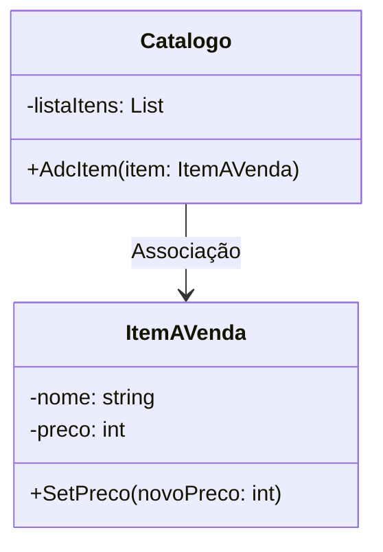

## Conceitos avançados de orientação a objetos – relacionamentos horizontais

### **1. Introdução**
O tópico aborda conceitos avançados de Programação Orientada a Objetos (POO), focando em relacionamentos horizontais entre classes, coleções de dados em C#, diagramas UML e métodos construtores/destrutores. Esses conceitos são essenciais para modelar sistemas complexos e garantir a eficiência e organização do código.
### **2. Coleções de Dados em C#**
Coleções são estruturas que agrupam objetos relacionados, permitindo operações dinâmicas como adição, remoção e ordenação. Em C#, as coleções são divididas em genéricas (tipadas) e não genéricas (baseadas em `object`). As principais coleções genéricas incluem:

- **List\<T>**: Lista dinâmica com métodos como `Add`, `Remove`, e `Sort`.
- **SortedList\<K, V>**: Armazena pares chave-valor ordenados por chave.
- **Stack\<T>**: Segue o princípio LIFO (último a entrar, primeiro a sair).
- **Queue\<T>**: Segue o princípio FIFO (primeiro a entrar, primeiro a sair).
- **Dictionary\<K, V>**: Mapeia chaves únicas a valores, ideal para buscas rápidas.
- **HashSet\<T>**: Conjunto de valores únicos, útil para operações de união e interseção.

**Recomendação**: Prefira coleções genéricas (`System.Collections.Generic`) para evitar erros de tipo e melhorar desempenho.

---

### **3. Diagramas de Classes UML**
Diagramas de classes são ferramentas visuais para modelar a estrutura de um sistema, mostrando classes, atributos, métodos e relacionamentos. Elementos principais:

- **Classes**: Representadas por retângulos com nome, atributos e métodos.
- **Relacionamentos**:
  - **Associação**: Conexão entre classes (ex: `Catalogo` usa `ItemAVenda`).
  - **Agregação**: Relação "tem um" onde a parte existe independentemente (ex: `Carro` tem `Pneu`).
  - **Composição**: Relação mais forte, onde a parte não existe sem o todo (ex: `Janela` contém `Botão`).
  - **Herança**: Relação "é um" (ex: `Cachorro` herda de `Animal`).

**Exemplo**:


---

### **4. Agregação e Composição em C#**
- **Agregação**:  
  - Objetos partes existem independentemente do todo.  
  - Exemplo: `Pessoa` tem um `Endereço`, mas o endereço pode existir sem a pessoa.  
  - Implementação: Usa referências (propriedades) para objetos externos.

  ```csharp
  public class Pessoa {
      public Endereco Endereco { get; set; } // Agregação
  }
  ```

- **Composição**:  
  - Objetos partes são gerenciados pelo todo e não existem sem ele.  
  - Exemplo: `Janela` contém `Botão`; se a janela for destruída, o botão também será.  
  - Implementação: Objetos partes são instanciados dentro da classe todo.

  ```csharp
  public class Janela {
      private Botao _botao = new Botao(); // Composição
  }
  ```

---

### **5. Construtores e Destrutores**
- **Construtores**:  
  - Métodos especiais chamados na criação de objetos.  
  - Tipos:
    - **Padrão**: Sem parâmetros (`public Pessoa()`).
    - **Parametrizado**: Aceita parâmetros para inicialização (`public Pessoa(string nome)`).
    - **Cópia**: Clona um objeto existente.
    - **Privado**: Usado em padrões como Singleton.
    - **Estático**: Inicializa membros estáticos da classe.

  ```csharp
  public class Pessoa {
      public Pessoa() { } // Construtor padrão
      public Pessoa(string nome) { } // Construtor parametrizado
  }
  ```

- **Destrutores**:  
  - Liberam recursos antes da destruição do objeto.  
  - Chamados automaticamente pelo coletor de lixo (`~Pessoa()`).  
  - Úteis para fechar arquivos ou conexões de banco de dados.

  ```csharp
  public class Pessoa {
      ~Pessoa() { Console.WriteLine("Destruído"); }
  }
  ```

---

### **6. Conclusão**
Este tópico explorou:
- **Coleções**: Organização eficiente de dados.
- **UML**: Modelagem clara de classes e relacionamentos.
- **Agregação/Composição**: Diferenças entre relacionamentos "tem um".
- **Construtores/Destrutores**: Controle do ciclo de vida de objetos.

**Próximos passos**:
- Pratique a implementação de coleções e relacionamentos em projetos.
- Use diagramas UML para planejar sistemas antes da codificação.
- Experimente diferentes tipos de construtores para cenários específicos.